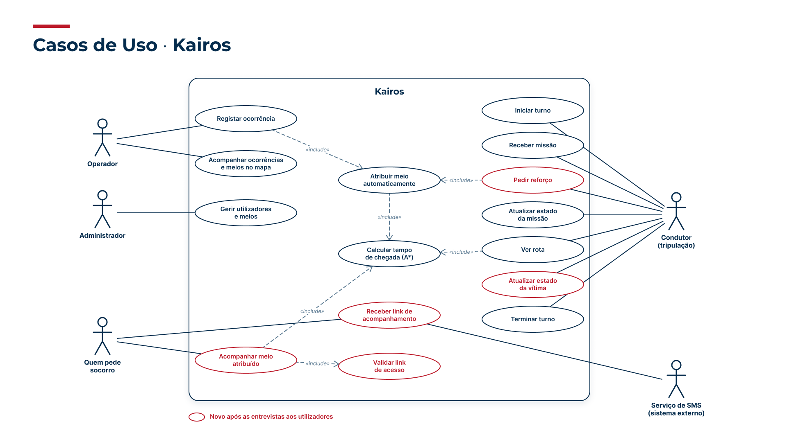
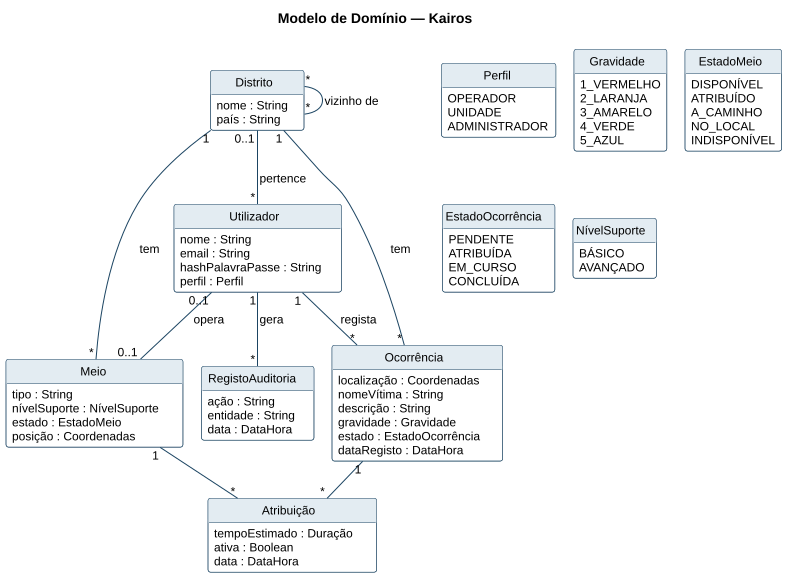
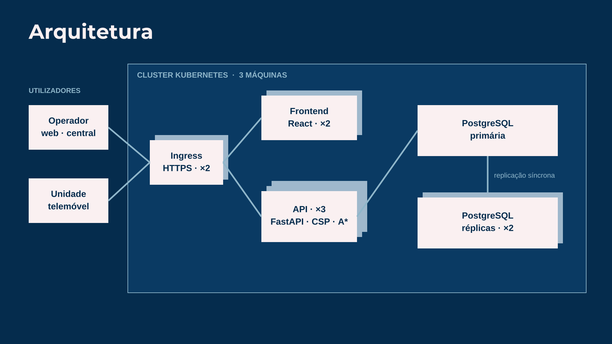

# Kairos - Sistema Distribuído de Despacho de Emergências

**Universidade Europeia / IADE - Engenharia Informática**  
**Projeto Multidisciplinar - 5º semestre (2026/2027)**  
**Grupo 08**  
**Elementos do Grupo**: Pedro António - 20241273, Mateus Reis - 20241799, Francisco Abecasis - 20240120, Deolindo Soares - 20221446

**GitHub**: [Repositório GitHub](https://github.com/MelhorNarrador/Projeto_de_Desenvolvimento_de_Software)  
**Trello**: [Trello](https://trello.com/invite/b/6ac8f867a984782bfd86969a/ATTI8f82f4240e1f515c5cfdc93e4f7387da96C105E2/projeto-kairos)  

---

  

---

## Palavras-chave
sistemas distribuídos, tolerância a faltas, despacho de emergências, Kubernetes, replicação, problemas de satisfação de restrições, A*, tempo real

---

## 1. Introdução

Este relatório apresenta a segunda versão do projeto **Kairos**, desenvolvido no âmbito do projeto multidisciplinar de 5.º semestre da Licenciatura em Engenharia Informática. É uma extensão do relatório v1, mantém a conceção (secções 2 a 14), atualizada com as decisões tomadas durante a implementação, e acrescenta o desenvolvimento do protótipo, os testes realizados e os seus resultados (secções 15 a 17).

A **Kairos** é uma plataforma web de despacho de emergências que recebe ocorrências, acompanha em tempo real a posição e o estado das unidades de socorro e **atribui automaticamente a unidade mais adequada a cada ocorrência**, calculando a rota mais rápida até ao local.

Por se tratar de um sistema crítico, a plataforma é construída sobre uma **arquitetura distribuída e tolerante a faltas**, todos os componentes estão replicados e, a falha de um servidor, de uma réplica da base de dados ou de uma máquina inteira não interrompe o serviço de forma permanente nem provoca a perda de ocorrências confirmadas.

Esta **segunda entrega (Protótipo)** centra-se na implementação, API replicada com atribuição automática (A* e CSP), interfaces web para o operador e para a tripulação, atualizações em tempo real, construção automática das imagens (GitHub Actions), cluster k3s com três máquinas virtuais no **Google Cloud**, base de dados replicada com CloudNativePG, HTTPS e os primeiros testes de falha com métricas.

---

## 2. Metodologia

O projeto segue uma **metodologia ágil baseada em Kanban**. O trabalho flui de forma contínua por um quadro de tarefas, em vez de ser organizado em ciclos fechados, o que se adapta melhor a uma equipa com disponibilidades variáveis ao longo do semestre. Para garantir o cumprimento das três entregas, o quadro é complementado por **milestones** com datas fixas.

O quadro é gerido no **Trello** o que garante a rastreabilidade de todo o trabalho realizado. O código é revisto e integrado através do **GitHub**.

### 2.1 Quadro Kanban

| Coluna | Significado |
|---|---|
| **Backlog** | Tarefas identificadas, ainda não priorizadas |
| **To Do** | Tarefas priorizadas para o marco atual, prontas a ser iniciadas |
| **Doing** | Tarefas em desenvolvimento, com um responsável atribuído |
| **Blocked** | Tarefa bloqueada, espera por ajuda de outro elemento ou finalização de outra tarefa |
| **In Review** | Tarefa concluída, espera por testes e revisão por outro elemento |
| **Done** | Tarefa revista e integrada no ramo principal |

### 2.2 Regras de Trabalho

| Regra | Descrição |
|---|---|
| **Limite de trabalho em curso (WIP)** | Cada elemento tem no máximo 2 tarefas em "Doing" em simultâneo |
| **Uma tarefa, um cartão** | Todo o trabalho é registado como cartões no Trello, com responsável e etiquetas |
| **Definição de Done** | Uma tarefa só passa a "Done" quando o código ou documento está revisto, integrado e testado |
| **Ponto de situação semanal** | Reunião curta com o quadro como base: o que avançou, o que está bloqueado e o que se segue |

### 2.3 Etiquetas

| Tipo | Etiquetas |
|---|---|
| **Natureza da tarefa** | `Feature`, `Bugs`, `Docs`, `Teste`, `Infra` |
| **Área** | `SD`, `IA`, `Seg`, `ES` |
| **Prioridade** | `Alta`, `Média`, `Baixa` |

### 2.4 Marcos (Milestones)

| Marco | Data | Objetivo | Estado |
|---|---|---|---|
| **Entrega 1 – Conceção** | 11/10/2026 | Problema, requisitos, arquitetura, modelo de faltas, relatório v1 | Concluído |
| **Entrega 2 – Protótipo** | 15/11/2026 | Cluster Kubernetes, backend replicado, CSP e A* funcionais, primeiros testes de falha, relatório v2 | Concluído |
| **Entrega 3 – Versão final** | 20/12/2026 | Frontend completo, segurança, testes de falha automatizados, demonstração, relatório final | Em curso |

Cada marco agrupa os cartões que têm de estar concluídos até à respetiva data, permitindo acompanhar no Trello a percentagem de trabalho concluído em cada entrega.

Este relatório corresponde ao marco **Entrega 2 – Protótipo**.  

---

## 3. Problema

Numa emergência, o tempo até à chegada do socorro é determinante. Em situações como uma paragem cardiorrespiratória, cada minuto de atraso reduz de forma significativa as hipóteses de sobrevivência e, parte desse tempo é gasto **antes da unidade sair**, à espera que a chamada chegue a quem despacha e a decidir que meio enviar e por onde.

Em muitos cenários esta decisão depende do operador, que escolhe a unidade com base na experiência e numa lista de meios disponíveis. Esta abordagem apresenta os seguintes problemas:

| Problema | Consequência |
|---|---|
| O operador não sabe com exatidão **quanto tempo** cada unidade demora a chegar | A unidade mais próxima em linha reta pode não ser a mais rápida pelas ruas |
| As ambulâncias **não têm GPS** ligado à central | A central não sabe onde está cada viatura, a escolha baseia-se no que é comunicado por rádio |
| Toda a informação é comunicada **por rádio** | A informação pode perder-se ou ser mal entendida, e a tripulação não recebe a missão por escrito |
| A rota depende do **conhecimento empírico do condutor** ou de aplicações como Waze | Numa zona que não conhece, o condutor pode escolher um caminho mais lento ou perder tempo a interagir com aplicações de GPS |
| **Ligar a chamada a quem despacha** pode demorar | Quem pede socorro pode ficar 40 minutos ou mais à espera, sem saber se a ajuda vem |
| Não existe **visão do conjunto** | Uma zona pode ficar sem unidades disponíveis sem que ninguém se aperceba, e uma ocorrência leve pode ficar com a unidade que uma ocorrência crítica vai precisar logo a seguir |  

A estes problemas soma-se um requisito técnico, uma central de emergência **não pode parar**. Se o servidor que a suporta falhar, as ocorrências deixam de ser registadas e atribuídas. Um sistema centralizado num único servidor representa um ponto único de falha inaceitável neste contexto.

A **Kairos** ataca estes problemas em duas frentes, **decidir melhor e mais depressa**, através de Inteligência Artificial, e **nunca parar**, através de uma arquitetura distribuída e tolerante a faltas.

---

## 4. Objetivos & Motivação

### 4.1 Objetivos

- Desenvolver uma plataforma web responsiva de despacho de emergências.
- Registar ocorrências e acompanhar unidades de socorro num mapa em tempo real.
- Atribuir automaticamente unidades a ocorrências através de **CSP**, com reatribuição quando surge uma ocorrência mais grave.
- Calcular rotas pela rede de estradas real através do algoritmo **A***.
- Garantir que **nenhuma ocorrência confirmada é perdida**, mesmo perante a falha de componentes.
- Manter o serviço disponível perante a falha de qualquer componente individual ou de uma máquina inteira.
- Demonstrar experimentalmente a tolerância a faltas através de testes de falha.

### 4.2 Motivação

A escolha do tema nasce da experiência pessoal de um dos elementos do grupo. Quem já ligou para o 112 conhece a espera, primeiro, até a chamada ser ligada a quem decide o socorro, depois, até a ambulância chegar. Em nenhum desses momentos quem pede ajuda sabe o que está a acontecer, nem se a ajuda vem a caminho.

A Kairos pretende resolver estes dois problemas:  

- Eliminar o intermediário: em vez de a chamada ter de ser transferida para o CODU, o pedido chega diretamente a quem despacha e o sistema escolhe e envia de imediato o meio mais rápido.  
- Dar informação a quem pede socorro: quem liga recebe o acesso a uma página com a sua ocorrência, onde pode ver a ambulância a aproximar-se e o tempo estimado de chegada, trocar a incerteza por informação não encurta a viagem, mas reduz a ansiedade de quem espera. Esta página está prevista para a 3.ª entrega.  

Os sistemas de despacho são um exemplo claro de sistema onde a **distribuição é necessária**, a disponibilidade e a integridade dos dados têm impacto direto na vida das pessoas. Este contexto permite trabalhar, de forma justificada, todos os conceitos centrais de sistemas distribuídos (replicação, consistência, deteção de falhas e recuperação), ao mesmo tempo que oferece problemas reais para as restantes UCs.  

---

## 5. Atores

| Ator | Descrição | Necessidade principal |
|---|---|---|
| **Operador da central** | Recebe chamadas e regista ocorrências, supervisiona o estado de todas as unidades do seu distrito | Enviar rapidamente unidades |
| **Unidade de socorro** | Tripulação da ambulância, quem conduz a viatura | Receber a missão, a rota e atualizar o seu estado (a caminho, no local, disponível) |
| **Quem pede socorro** | Vítima ou quem liga para a emergência | Saber que a ajuda vem e quando chega (página de acompanhamento prevista para a E3) |
| **Administrador** | Gere utilizadores e unidades | Configurar o sistema e consultar o registo de auditoria |

---

## 6. Pesquisa de mercado

Os sistemas de despacho assistido por computador (**CAD – Computer-Aided Dispatch**) são utilizados por serviços de emergência em todo o mundo. Em Portugal, as chamadas de emergência médica são encaminhadas para os **CODU** (Centros de Orientação de Doentes Urgentes) do INEM.

| Solução | Pontos fortes | Limitações | Oportunidade para a Kairos |
|---|---|---|---|
| **Sistemas CAD comerciais** | Completos, integrados com comunicações rádio e telefone | Soluções proprietárias, de custo elevado e pouco transparentes | Demonstrar os mecanismos de decisão e de tolerância a faltas de forma aberta |
| **Despacho manual com mapa** | Simples, controlado pelo operador | Decisão dependente da experiência. Sem estimativa de tempos reais | Proposta automática baseada em tempos de chegada calculados |
| **Atribuição pela unidade mais próxima** | Rápida e fácil de implementar | Decisão isolada por ocorrência, ignora prioridades e cobertura | Decisão conjunta de várias ocorrências, com reatribuição por prioridade |

A **Kairos** diferencia-se por combinar, num só sistema:

1. **Atribuição otimizada** de várias ocorrências em simultâneo, com restrições explícitas (CSP).
2. **Reatribuição dinâmica** de unidades em trânsito quando surge uma ocorrência mais grave.
3. **Tempos de chegada reais**, calculados pela rede de estradas (A*).
4. **Tolerância a faltas demonstrável**, com garantias explícitas sobre disponibilidade e perda de dados.

O sistema é pensado para ser instalado **por país** (uma instalação por país, os dados de saúde ficam no país), com os dados divididos por **distrito**, cada operador só vê o seu distrito e os distritos vizinhos podem emprestar unidades.

---

## 7. Requisitos

### 7.1 Requisitos Funcionais

| ID | Requisito | Estado na E2 |
|---|---|---|
| RF01 | Autenticação de utilizadores com perfis de operador, unidade e administrador | **Parcial**: login com bcrypt e encaminhamento por perfil, tokens JWT na E3 |
| RF02 | Registo de ocorrências com localização, nome da vítima, descrição breve e **nível de gravidade** (ver 7.5) | **Feito** |
| RF03 | Visualização das ocorrências e unidades do distrito num mapa em tempo real | **Feito** |
| RF04 | Atribuição automática de unidades (CSP) | **Feito** |
| RF05 | Reatribuição de unidades em trânsito quando surge uma ocorrência de gravidade superior | E3 |
| RF06 | Pedido de apoio a distritos vizinhos quando o distrito não tem unidades adequadas | E3 |
| RF07 | Cálculo e apresentação da rota mais rápida até à ocorrência (A*) | **Feito** |
| RF08 | Vista da unidade: escolher a viatura, receber missão, ver rota e atualizar estado | **Feito** |
| RF09 | Atualização periódica da posição das unidades | **Feito** |
| RF10 | Gestão de unidades e utilizadores (administrador) | E3 |
| RF11 | Registo de auditoria de todas as atribuições e informações relevantes | **Feito** |

### 7.2 Requisitos Não Funcionais

| ID | Categoria | Requisito | Estado na E2 |
|---|---|---|---|
| RNF01 | Desempenho | A atribuição é feita em menos de 2 segundos após o registo da ocorrência | **Cumprido**: 0,1–0,6s em carga normal (16.1) |
| RNF02 | Tempo real | Alterações de estado chegam aos utilizadores interessados em menos de 1 segundo | **Cumprido**: ~8ms entre réplicas (15.4) |
| RNF03 | Recuperação | Após a falha de um componente, a redundância é reposta automaticamente | **Cumprido** (16.3) |
| RNF04 | Rastreabilidade | Todas as decisões de atribuição ficam registadas com autor e data | **Cumprido**: tabela `audit_log` |
| RNF05 | Usabilidade | Interface responsiva, utilizável em computador e no telemóvel da unidade | **Parcial** |
| RNF06 | Disponibilidade | O serviço mantém-se disponível perante a falha de qualquer componente individual ou de uma máquina do cluster | **Cumprido com interrupção**, na queda da máquina da base de dados primária as escritas param 1 a 3 minutos (16.3) |
| RNF07 | Integridade | Nenhuma ocorrência confirmada é perdida | **Cumprido** nos testes realizados |
| RNF08 | Segurança | Toda a comunicação externa é cifrada e o acesso é controlado por perfil | **Parcial**: HTTPS feito; controlo de acesso no servidor na E3 |
| RNF09 | Privacidade | Os dados pessoais das vítimas são cifrados na base de dados e só são visíveis a quem trata a ocorrência | E3 |

### 7.3 Casos de Uso

### 7.4 Modelo de Domínio

### 7.5 Escala de Gravidade

A gravidade de cada ocorrência é atribuída pelo operador numa escala de cinco níveis, inspirada na **Triagem de Manchester** utilizada nos serviços de urgência hospitalar em Portugal.

| Nível | Cor | Exemplos | Tempo-alvo de chegada | Peso no CSP |
|---|---|---|---|---|
| **1 – Emergente** | Vermelho | Paragem cardiorrespiratória, vítima inconsciente | 8 min | 16 |
| **2 – Muito urgente** | Laranja | Dor torácica, suspeita de AVC, hemorragia grave | 15 min | 8 |
| **3 – Urgente** | Amarelo | Fratura exposta, queimadura moderada | 30 min | 4 |
| **4 – Pouco urgente** | Verde | Fratura fechada, entorse, ferida ligeira | 60 min | 2 |
| **5 – Não urgente** | Azul | Transporte não urgente, queixa ligeira | 120 min | 1 |

Os tempos-alvo e os pesos são **definidos pelo grupo para este projeto**. Os tempos da Triagem de Manchester referem-se à observação médica no hospital e não à chegada de meios ao local.

---

## 8. Arquitetura Distribuída

### 8.1 Visão Geral

  

O sistema corre num cluster **Kubernetes (k3s)** com **três nós**, cada um numa máquina virtual distinta do **Google Cloud** (3× e2-medium, região europe-southwest1, uma por zona: a, b e c). Todos os nós executam serviços aplicacionais. Os três nós são **servidores** k3s com etcd embutido, pelo que a perda de qualquer nó não compromete a gestão do cluster.

As instâncias da base de dados estão **obrigatoriamente** em nós diferentes (*pod anti-affinity* obrigatória no CloudNativePG). Os restantes componentes têm mais réplicas do que as necessárias para servir o tráfego, e o Kubernetes recria noutro nó as réplicas de uma máquina que falhe.

### 8.2 Componentes

| Camada | Componente | Função | Mecanismo de redundância |
|---|---|---|---|
| Entrada | **Ingress (Traefik)** | Ponto de entrada HTTPS, encaminha `/api` diretamente para a API e o resto para o frontend | 2 réplicas. O serviço é exposto em todos os nós (ServiceLB do k3s), pelo que qualquer nó aceita pedidos |
| Entrada | **cert-manager** | Obtém e renova o certificado HTTPS (Let's Encrypt) | Recria o certificado se necessário |
| Cliente | **Frontend** (HTML, JavaScript e Leaflet, servido por nginx) | Interfaces do operador e da tripulação | `Deployment` com 2 réplicas |
| Serviços | **API** (FastAPI) | Login, ocorrências, unidades, despacho (CSP + A*), rotas, WebSockets | `Deployment` stateless com 3 réplicas, o `Service` distribui os pedidos |
| Dados | **PostgreSQL** | Ocorrências, unidades, atribuições, utilizadores, auditoria | **CloudNativePG** com 3 instâncias (1 primária + 2 réplicas, uma por nó), replicação em streaming, réplica síncrona e failover automático |
| Controlo | **Operador CloudNativePG** | Deteta a falha da primária e promove uma réplica | 3 réplicas com eleição de líder |
| Controlo | **CoreDNS** | Resolve os nomes internos | 3 réplicas, uma por nó |

As réplicas do operador CloudNativePG e do CoreDNS foram acrescentadas depois de os testes de falha mostrarem que, com uma só réplica, eram **pontos únicos de falha** (16.4).

### 8.3 Fluxo Principal

| # | Passo |
|---|---|
| 1 | O operador preenche o formulário da ocorrência e o pedido chega a qualquer réplica da API |
| 2 | A API grava a ocorrência com o estado *pendente* e responde de imediato ao operador |
| 3 | Depois da resposta, a mesma réplica corre o CSP sobre as ocorrências pendentes do distrito e os meios disponíveis |
| 4 | A atribuição é gravada numa transação com escritas condicionais (8.4) |
| 5 | Um *trigger* da BD emite um aviso (`NOTIFY`), todas as réplicas da API recebem-no e reenviam-no por WebSocket aos operadores do distrito e à unidade atribuída, que atualizam o ecrã |

A BD funciona simultaneamente como armazenamento e como fila de trabalho, uma ocorrência só sai do estado *pendente* quando a sua atribuição é gravada. Assim, uma falha a meio do processamento não perde a ocorrência, que continua pendente e é retomada pela verificação periódica de 30 em 30 segundos.

### 8.4 Decisões Arquiteturais

| Decisão | Justificação |
|---|---|
| **Kubernetes (k3s) com 3 servidores** | Recria automaticamente componentes que falham, distribui réplicas por várias máquinas e oferece deteção de falhas. Com 3 servidores, qualquer máquina pode falhar |
| **API stateless** | Qualquer réplica atende qualquer pedido, a falha de uma réplica não perde estado. Na E3 a sessão passa a ser um token **JWT**, que também não guarda estado no servidor |
| **Base de dados replicada** | Todas as garantias necessárias (durabilidade, ordem, exclusão mútua) são asseguradas pela BD |
| **Sem fila de mensagens nem eleição de líder na aplicação** | A BD já garante que um pedido confirmado não se perde. Uma fila seria mais um componente a replicar e obrigaria a manter BD e fila consistentes (escrita dupla) |
| **Réplica síncrona** no PostgreSQL (quórum 1 de 2 réplicas) | Uma transação só é confirmada depois de existir também numa réplica, pelo que o failover não perde dados confirmados |
| **`dataDurability: preferred`** | Se as duas réplicas falharem, a primária continua a aceitar escritas sem cópia síncrona. É uma escolha de disponibilidade em vez de durabilidade total, adequada a um sistema de emergência |
| **Consistência forte** nas atribuições | A atribuição é um UPDATE condicional, por isso um meio nunca é atribuído duas vezes, mesmo com várias réplicas da API. Se duas réplicas disputarem o mesmo meio, a que perde volta a correr o CSP |
| **Tempo real com LISTEN/NOTIFY + WebSockets** | Não exige componentes extra, a própria BD avisa todas as réplicas da API. O aviso leva só o número do distrito e o cliente volta a ler o estado. Uma verificação periódica de 30 s cobre avisos perdidos |
| **API verificada só por *readiness*** | Durante um failover a API deixa de estar pronta e deixa de receber tráfego, uma *liveness probe* reiniciaria todas as réplicas ao mesmo tempo sem resolver nada |

---

## 9. Modelo de Faltas

| Questão | Resposta |
|---|---|
| **Componentes que podem falhar** | Pods da API, do frontend e do ingress. Primária ou réplica do PostgreSQL. Uma máquina inteira do cluster. Ligação de rede entre componentes ou de um cliente |
| **Tipos de falha considerados** | Falha por paragem (*crash*) o componente deixa de responder. Interrupção temporária de comunicação |
| **Falhas simultâneas suportadas** | A falha de **uma máquina do cluster** (e de todos os pods que nela correm) |
| **Funcionalidades disponíveis após a falha** | Todas, registo de ocorrências, atribuição, rotas, mapa em tempo real e vista das unidades. Se a máquina perdida tinha a primária, as escritas ficam indisponíveis até ao fim do failover (16.3) |
| **Deteção da falha** | *Readiness probes* do Kubernetes nos pods. Estado *NotReady* dos nós. Monitorização da primária pelo CloudNativePG. *TCP keepalives* nas ligações da API à BD |
| **Recuperação ou substituição** | O Kubernetes recria os pods em falha, noutro nó se necessário, e o tráfego deixa de ser enviado para pods em falha. O CloudNativePG promove uma réplica a primária, a antiga primária volta como réplica |
| **Informação que pode ser perdida** | Nenhuma ocorrência ou atribuição **confirmada**. Um pedido em curso no momento da falha pode falhar e o operador repete-o (pode gerar duplicados, corrigido na E3 com uma chave de idempotência). Avisos em tempo real emitidos durante a falha podem perder-se, mas o cliente recupera o estado atual ao religar. A última posição de um meio pode perder-se, sendo substituída pela seguinte |
| **Consistência entre réplicas** | Réplica síncrona do PostgreSQL (quórum 1 de 2) |

---

## 10. Cenários de Demonstração de Falhas

| # | O que falha | Deteção | O que mantém o serviço | Impacto | Perda de dados | Recuperação e reposição |
|---|---|---|---|---|---|---|
| F1 | Pod da API | *Probe* do Kubernetes | As outras réplicas recebem os pedidos | Os WebSockets dessa réplica religam automaticamente a outra | Nenhuma | Pod recriado |
| F2 | Pod da API a meio de um registo | *Probe* do Kubernetes | A ocorrência fica pendente e é atribuída na próxima execução do CSP | Atribuição atrasa até 30 s | Nenhuma | Pod recriado |
| F3 | PostgreSQL primária | CloudNativePG | Réplica promovida a primária | Escritas falham durante o failover | Nenhuma confirmada | Antiga primária volta como réplica |
| F4 | Máquina inteira | Nó passa a *NotReady* | Réplicas nos outros nós continuam a servir | Degradação durante a recuperação | Nenhuma confirmada | Pods recriados nos outros nós |
| F5 | Ligação de rede de uma unidade | Erro no envio | Ao religar, o ecrã volta a ler o estado do servidor | Posição desatualizada temporariamente | Nenhuma | A posição seguinte substitui a anterior |

Além das falhas, é demonstrado o cenário de **concorrência**, ocorrências registadas ao mesmo tempo, em réplicas diferentes, que disputam os mesmos meios. Cada meio fica com uma só ocorrência e as outras recebem a melhor alternativa.

---

## 11. Componente de Inteligência Artificial

A IA resolve dois problemas: **que meio enviar** (CSP) e **quanto tempo demora e por onde** (A*). Ambos correm dentro da API.

### 11.1 Atribuição de Meios - CSP

Sempre que é registada uma ocorrência, um meio inicia o turno ou termina uma missão, e periodicamente a cada 30 segundos, a API corre o CSP sobre as ocorrências pendentes desse distrito. A execução periódica garante que uma ocorrência que ficou pendente por falha de uma réplica é retomada.

| Elemento | Descrição (implementação na E2) |
|---|---|
| **Variáveis** | Uma por ocorrência pendente |
| **Domínios** | Todos os meios disponíveis do distrito que cumprem as restrições, ordenados do mais barato para o mais caro, mais o valor "sem meio por agora" (custo de 3600s × peso). |
| **Restrições obrigatórias** | Cada meio só pode ir para uma ocorrência. Os níveis 1 e 2 exigem suporte avançado, uma ocorrência vermelha sem meio avançado livre fica pendente |
| **Custo a minimizar** | Soma de (tempo de chegada pelo A* × peso da gravidade: 16 / 8 / 4 / 2 / 1) |
| **Resolução** | Backtracking com **MRV** (primeiro a ocorrência com menos opções livres, em empate, a mais grave) e **branch and bound**. Limite de 1,5s como rede de segurança, devolve a melhor solução encontrada |
| **Limite inferior (B&B)** | Custo até agora + a opção livre mais barata de cada ocorrência que falta (ignora conflitos, logo nunca sobrestima). |
| **Envelhecimento (*aging*)** | Uma ocorrência pendente sobe um nível de peso por cada 20 minutos de espera, até ao nível 2, para não ficar esquecida. Nunca ultrapassa um vermelho real e nunca altera a exigência de suporte avançado |  

**Consistência e inferência:**
- **Consistência de nó**: as restrições unárias (suporte avançado) filtram os domínios antes da pesquisa.
- **Forward checking**: implícito, através do conjunto de meios já usados e da contagem de opções livres do MRV.
- **AC-3**: não elimina nenhum valor neste problema, porque todos os domínios contêm "sem meio por agora", pelo que qualquer valor tem sempre suporte.

**Desempate quando duas ocorrências querem o mesmo meio:**

| Ordem | Critério |
|---|---|
| 1 | **Gravidade**: a mais grave fica com o meio (peso maior) |
| 2 | **Quem perde mais sem ele**: o meio vai para a ocorrência cuja alternativa é pior (resulta do custo total do CSP) |
| 3 | **Antiguidade**: a ocorrência à espera há mais tempo, através do envelhecimento |

### 11.2 Cálculo de Rotas - A*

| Elemento | Descrição |
|---|---|
| **Grafo** | Rede de estradas de Lisboa e da Península de Setúbal, obtida do OpenStreetMap com OSMnx: 56 183 nós e 123 691 arestas dirigidas. Só a **maior componente fortemente conexa** |
| **Custo** | Tempo de viagem de cada troço (comprimento ÷ velocidade máxima da via) |
| **Heurística** | Distância em linha reta ÷ 120 km/h (velocidade máxima da rede): **admissível** |
| **Consistência da heurística** | Verificada em todas as 123 691 arestas |
| **Pontos de partida e chegada** | A posição da ocorrência e a da unidade são ligadas ao nó do grafo mais próximo. Esse nó não pode ser de autoestrada ou via rápida, a não ser que fique a menos de 25m. |
| **Utilização** | Tempos de chegada para o CSP (a partir da posição GPS real da unidade) e rota desenhada no mapa com a geometria das estradas |

---

## 12. Segurança

| Área | Medida | Estado na E2 |
|---|---|---|
| **Autenticação** | Palavras-passe com *hash* (bcrypt), tokens **JWT** com validade curta | bcrypt **feito**, JWT na E3 |
| **Autorização** | Acesso por perfil e por distrito, o operador só vê o seu distrito, a unidade só vê a sua missão | Feito na interface, **verificação no servidor na E3** |
| **Dados pessoais** | Nome da vítima e descrição cifrados na BD, recolhem-se apenas os dados necessários (RGPD) | E3. Os avisos em tempo real não levam dados de vítimas |
| **Comunicação** | HTTPS e WebSockets cifrados no ingress | **Feito**, certificado Let's Encrypt via cert-manager, renovado automaticamente |
| **Segredos** | Credenciais em *Secrets* do Kubernetes, nunca no repositório | **Feito** para a BD |
| **Auditoria** | Registo de todas as atribuições e alterações, com utilizador e data | **Feito** |
| **Proteção da API** | Validação dos dados de entrada | **Feito** (modelos Pydantic, consultas SQL parametrizadas) |
| **Acesso ao cluster** | API do Kubernetes protegida por firewall | **Feito**, porta 6443 aberta só a IPs autorizados |

---

## 13. Tecnologias Utilizadas

| Camada | Tecnologias |
|---|---|
| **Frontend** | HTML, JavaScript, Leaflet, OpenStreetMap, Photon (pesquisa de moradas), WebSockets. Reescrita em React prevista para a E3 |
| **Backend** | Python, FastAPI, psycopg 3 (assíncrono, com *pool* de ligações), bcrypt |
| **Inteligência Artificial** | Python, OSMnx (obtenção do grafo de estradas, offline) |
| **Base de Dados** | PostgreSQL, CloudNativePG 1.25 |
| **Infraestrutura** | Docker, Kubernetes (k3s), Traefik, cert-manager, Let's Encrypt, Google Cloud (Compute Engine) |
| **CI/CD** | GitHub Actions, GitHub Container Registry (GHCR) |
| **Ferramentas** | GitHub, Trello, VS Code, Headlamp, k3d (cluster local de ensaio), Discord |

---

## 14. Guiões de Teste

### Guião 1 - Registar ocorrência (Core)

1. O operador do distrito de Lisboa autentica-se.
2. Abre o formulário de nova ocorrência e preenche morada (pesquisa), nome da vítima, descrição breve e nível 1 (vermelho).
3. O sistema atribui automaticamente a ambulância de suporte avançado com menor tempo de chegada.
4. A unidade recebe a missão e a rota de imediato, e a atribuição aparece no mapa do operador.

**Resultado esperado**, o meio é atribuído em menos de 2 segundos.  
**Resultado na E2**, cumprido (0,1–0,6s em carga normal).

### Guião 2 - Reatribuição por gravidade

1. Uma ambulância está a caminho de uma ocorrência de nível 4 (verde).
2. É registada uma ocorrência de nível 1 próxima, sem outro meio adequado disponível.
3. A ambulância é desviada para a ocorrência de nível 1.

**Resultado esperado**, a ocorrência de nível 4 volta a ficar pendente e recebe outro meio quando houver.  
**Resultado na E2**, não testado (reatribuição prevista para a E3).

### Guião 3 - Ocorrências simultâneas

1. Dois operadores registam ao mesmo tempo ocorrências próximas, com apenas uma ambulância disponível por perto.
2. Os pedidos chegam a réplicas diferentes da API.

**Resultado esperado**, a ambulância é atribuída a uma só ocorrência, segundo os critérios de desempate, a outra recebe a melhor alternativa.  
**Resultado na E2**, cumprido. Teste de carga com 20 ocorrências simultâneas em 3 réplicas, 0 atribuições duplicadas (16.1).

---

## 15. Desenvolvimento do Protótipo (2ª Entrega)

Esta segunda fase foi dedicada a implementar a infraestrutura e os algoritmos previstos na conceção, traduzindo-os num protótipo funcional a correr no cluster.

### 15.1 API

| Endpoint | Função |
|---|---|
| `GET /health` | Verificação de *readiness* usada pelo Kubernetes |
| `POST /login` | Autenticação (bcrypt), devolve o utilizador e o perfil |
| `GET /districts` | Lista de distritos |
| `GET /units?district_id=` · `GET /incidents?district_id=` · `GET /incidents/{id}` | Meios e ocorrências do distrito |
| `POST /incidents` | Registo de ocorrência, dispara o despacho depois da resposta |
| `POST /units/{id}/start-shift` · `POST /units/{id}/end-shift` | Início e fim de turno da tripulação |
| `PATCH /units/{id}/position` | Posição GPS da unidade |
| `PATCH /units/{id}/status` | Estados da missão, `assigned` → `en_route` → `on_scene` → `available` |
| `GET /units/{id}/route` | Rota A* desde a posição atual da unidade |
| `WS /ws?district_id=` | Avisos em tempo real |

Todas as alterações seguem o mesmo padrão, uma transação com um `UPDATE` **condicional** (`... WHERE` estado anterior esperado). Se a atualização afeta 0 linhas, a API responde **409 (conflito)** e nada é gravado. Assim, dois cliques seguidos, dois tripulantes a escolher a mesma viatura ou uma tentativa de saltar um passo da missão são sempre rejeitados de forma segura, mesmo com várias réplicas da API.

### 15.2 Base de Dados

| Tabela | Notas |
|---|---|
| `district`, `district_neighbor` | Distritos e vizinhanças (guardadas nos dois sentidos) |
| `app_user` | Perfis `operator`, `crew`, `admin`. Sem registo livre, as contas são criadas pelo administrador (gestão na E3), desativadas e nunca apagadas (preserva a auditoria) |
| `incident` | Gravidade 1–5, estado `pending` → `assigned` → `in_progress` → `closed` |
| `unit` | Indicativo, matrícula, nível de suporte (`basic`/`advanced`), estado, posição, missão atual e tripulante em turno |
| `assignment` | Histórico de atribuições com o tempo de chegada calculado, índice único garante no máximo uma atribuição ativa por meio |
| `audit_log` | Quem fez o quê e quando, `user_id` vazio = sistema |

Restrições na tabela `unit` garantem a coerência mesmo perante erros da aplicação, um meio sem ninguém em turno **nunca** pode ser atribuído, e um meio livre não pode ter missão (e vice-versa).

### 15.3 Despacho

| Elemento | Implementação |
|---|---|
| **Atribuição** | Corre o CSP numa *thread* separada (para não bloquear a API) e grava cada atribuição numa transação com escritas condicionais. Em caso de conflito desfaz tudo e volta a calcular |
| **Disparadores** | Nova ocorrência, início de turno, meio volta a disponível, e verificação periódica de 30s |
| **Rajadas** | Cada réplica junta pedidos de despacho do mesmo distrito que cheguem em rajada e corre no máximo um despacho por distrito de cada vez. É só uma otimização, a correção continua a ser garantida pela BD |

### 15.4 Tempo Real

Um *trigger* nas tabelas `incident` e `unit` emite um `NOTIFY` com o número do distrito. Cada réplica da API mantém uma ligação dedicada em `LISTEN` (com religação automática) e reenvia o aviso, por WebSocket, aos ecrãs ligados a esse distrito, que voltam a pedir os dados. Medido com 3 réplicas, **todas avisadas em ~8ms**. A verificação de 30s nos ecrãs mantém-se como rede de segurança.

### 15.5 Frontend

| Página | Funções |
|---|---|
| **Login** | Encaminha para a página do perfil |
| **Operador** | Mapa com as ocorrências e os meios do distrito, registo de ocorrências com pesquisa de moradas (Photon) |
| **Tripulação** | Escolha da viatura, início e fim de turno, missão atual, rota no mapa, botões de estado e envio da posição GPS do telemóvel |

### 15.6 Infraestrutura

| Elemento | Implementação |
|---|---|
| **Cloud** | **Google Cloud**, 3 VMs e2-medium (Ubuntu 24.04) em três zonas da região europe-southwest1, com IPs estáticos |
| **Cluster** | k3s com 3 servidores (etcd embutido), ligados pela rede interna. Ensaiado primeiro num cluster local k3d (1 servidor + 2 agentes) |
| **Imagens** | GitHub Actions constrói as imagens da API e do frontend para amd64 e arm64 e publica-as no GHCR |
| **Instalação** | Um script aplica os manifestos Kubernetes e escala o operador CloudNativePG e o CoreDNS para 3 réplicas |
| **Base de dados** | Configuração descrita em 8.2 e 8.4, o esquema e os dados de teste são carregados automaticamente na criação, a API liga sempre à primária atual |
| **Ligações à BD** | *Pool* com *TCP keepalives* e verificação da ligação antes de a usar, para detetar rapidamente a falha da primária |
| **HTTPS** | cert-manager + Let's Encrypt num domínio sslip.io, certificado renovado automaticamente |

---

## 16. Testes e Resultados

### 16.1 Concorrência e Desempenho do Despacho

| Teste | Resultado |
|---|---|
| 20 ocorrências simultâneas, 3 réplicas da API | **0 atribuições duplicadas** |
| Tempo de atribuição em carga normal | 0,1–0,6s |
| Caso extremo, 20 ocorrências × 20 meios ao mesmo tempo | 2–4s |

O teste de carga encontrou dois problemas, ambos corrigidos:

| Problema | Correção |
|---|---|
| **Thundering herd**, todas as réplicas despachavam o mesmo distrito ao mesmo tempo e entravam em conflito umas com as outras (20s) | Junção de rajadas por réplica (15.3), 0,6s |
| 330 nós do grafo sem ligação ao resto, ocorrências nesses pontos ficavam pendentes para sempre | Grafo reduzido à maior componente fortemente conexa |

### 16.2 Algoritmos de IA

| Teste | Resultado |
|---|---|
| Tempo do A* por rota | 14–36ms |
| A* vs. Dijkstra | O A* explora **43–58% menos nós** |
| Heurística não admissível (50km/h) | Rota pior em 14 de 40 viagens (até +10,9min). Mantida a heurística de 120km/h |
| CSP com limite inferior no branch and bound (15×15) | 0,251s → 0,009s (~28× mais rápido) |
| CSP 20×20 | Ainda atinge o limite de 1,5s em 2 de 5 cenários (antes 3 de 5), devolve a melhor solução encontrada |

### 16.3 Testes de Falha

**Ensaio no cluster local (k3d):**

| Teste | Resultado |
|---|---|
| F1, apagar as 3 réplicas da API | Recriadas, sem perda de dados |
| F3, paragem controlada da primária | 0 escritas falhadas, mas ~3,5min de espera (a primária espera que as ligações terminem) |
| F4, paragem abrupta do nó da primária | Promoção aos 53s, aplicação de volta aos 135s, a antiga primária volta como réplica em 12s |
| F4 depois das correções de 16.4 | Promoção aos 23s, **aplicação de volta aos 46s** |

**Cluster no Google Cloud:**

| Teste | Resultado |
|---|---|
| F1, reduzir a API de 3 para 2 e para 1 réplica | **0 pedidos falhados** |
| Arranque a frio das 3 VMs | Sistema volta sozinho (o frontend reinicia uma vez enquanto o DNS do cluster arranca) |
| F4, desligar à força a VM da primária | Leituras de volta em ~70s, escritas em ~165s. Uma ocorrência criada durante a falha ficou à espera e **foi gravada** (sem perda), a antiga primária volta como réplica em ~32s |

Em todos os testes **nenhuma ocorrência confirmada foi perdida**.

**Porque demora ~140s no Google Cloud**, depois da promoção, uma réplica da API ficou ~127s presa em tentativas de ligação TCP à primária que falhou. Como a replicação é síncrona, as escritas esperaram até essa ligação desistir. A redução das tentativas TCP fica para a E3.

### 16.4 Problemas Encontrados pelos Testes de Falha

| Problema | Consequência | Correção |
|---|---|---|
| Ligações da API presas na primária que falhou | ~80s a mais de indisponibilidade depois da promoção | *TCP keepalives* + verificação da ligação no *pool*, aplicação de volta 3s depois da promoção (no k3d) |
| **Operador CloudNativePG** com 1 réplica | Se estivesse no nó que falhou, não havia failover durante ~5min | 3 réplicas com eleição de líder, novo líder em ~19s |
| **CoreDNS** com 1 réplica | A API não conseguia resolver o endereço da BD | 3 réplicas, uma por nó |
| Antiga primária volta como réplica mas fica fora do quórum (~8min) | Sem segunda cópia síncrona durante esse tempo | Só volta ao quórum após uma nova escrita, um `CHECKPOINT` na primária resolve em ~15s. Automatizar na E3 |
| **Tempo real parou** após a queda da VM da primária | Os ecrãs só atualizavam pela verificação de 30s | A ligação `LISTEN` não usava os *keepalives* do *pool*. Solução temporária, reiniciar a API, correção na E3 (mesmos parâmetros TCP nas duas ligações) |
| Ocorrências duplicadas quando o operador repete o pedido durante a falha | Duplicados na lista | E3, botão desativado durante o envio + chave de idempotência por formulário |

### 16.5 Limitações Conhecidas

| Limitação | Plano |
|---|---|
| O domínio HTTPS aponta só para a primeira VM, se ela cair, o acesso é pelos IPs das outras (HTTP) | E3, load balancer do Google Cloud à frente das 3 VMs |
| Escritas indisponíveis 1 a 3 minutos na queda da máquina com BD primária | E3, menos tentativas TCP nos pods da BD |
| O servidor ainda confia no utilizador enviado no pedido (sem JWT) | E3, JWT + autorização por distrito em todas as consultas |
| Dados das vítimas em claro na BD | E3, cifra do nome e da descrição |

---

## 17. Planeamento

### 17.1 Tarefas da 2ª Entrega

| Data | # | Tarefa | Estado |
|---|---|---|---|
| 26/10/2026 | 1 | Mapa do operador com as ocorrências e os meios do distrito | Concluída |
| 26/10/2026 | 2 | Registar uma ocorrência com pesquisa de moradas | Concluída |
| 26/10/2026 | 3 | Ecrã da tripulação, escolher a viatura, ver a missão e o caminho até ao local | Concluída |
| 26/10/2026 | 4 | Atualizações automáticas (LISTEN/NOTIFY + WebSockets) | Concluída |
| 26/10/2026 | 5 | Construção automática das imagens (GitHub Actions) e manifestos Kubernetes | Concluída |
| 30/10/2026 | 6 | Sistema a funcionar em 3 máquinas na cloud (Google Cloud, k3s) | Concluída |
| 30/10/2026 | 7 | Base de dados com cópias em várias máquinas (CloudNativePG) | Concluída |
| 02/11/2026 | 8 | HTTPS e Ingress com 2 réplicas (cert-manager, Traefik) | Concluída |
| 02/11/2026 | 9 | Testes de falha | Concluída |
| 06/11/2026 | 10 | Relatório v2 e slides | Concluída |
| 09/11/2026 | 11 | Testes e guião para apresentação | Concluída |

### 17.2 Plano para a 3ª Entrega

| Área | Tarefas |
|---|---|
| **Segurança** | JWT com perfil e distrito, autorização por distrito em todas as consultas, cifra do nome e da descrição da vítima |
| **IA** | Reatribuição para ocorrências mais graves, apoio de distritos vizinhos, pré-seleção de candidatos por distância em linha reta (otimização) |
| **Tolerância a faltas** | Load balancer do Google Cloud, menos tentativas TCP nos pods da BD, *keepalives* na ligação de tempo real, chave de idempotência no registo de ocorrências, testes de falha automatizados |
| **Interfaces** | Reescrita do frontend em React, página de acompanhamento para quem pede socorro, gestão de utilizadores e unidades (administrador) |
| **Documentação** | Relatório final, demonstração e arquivo documental |

### 17.3 Riscos

| Risco | Probabilidade | Impacto | Mitigação | Estado |
|---|---|---|---|---|
| Complexidade do Kubernetes atrasar o projeto | Média | Alto | Ensaio local em k3d antes da cloud, plano alternativo com Docker Compose | Ultrapassado, cluster a funcionar desde 07/11 |
| Cloud indisponível (Azure não disponível para contas IADE) | Ocorreu | Alto | Google Cloud (período gratuito), plano B com 3 portáteis do grupo, plano C com k3d | Resolvido com o Google Cloud |
| Créditos da cloud esgotados antes da E3 | Baixa | Médio | Alerta de orçamento, VMs paradas quando não estão em uso | Controlado |
| Grafo de estradas demasiado grande para o A* | Média | Médio | Limitar a região da demonstração | Resolvido, 14–36ms por rota |
| CSP lento com muitas ocorrências pendentes | Baixa | Médio | Tempo limite, devolvendo a melhor solução encontrada, limite inferior no branch and bound | Mitigado (16.2) |
| Failover lento na queda da máquina da primária | Média | Alto | Ajustar os parâmetros TCP dos pods da BD | Planeado para a E3 |

---

## 18. Conclusão

A **Kairos** pretende demonstrar como uma arquitetura distribuída e tolerante a faltas, combinada com algoritmos de Inteligência Artificial, pode suportar um sistema crítico como uma central de despacho de emergências.

Na primeira fase (E1) foram definidos o problema, os requisitos, a arquitetura, o modelo de faltas e os cenários de falha a demonstrar. Nesta **2.ª entrega (Protótipo)**, o grupo implementou e testou o sistema:

- **Despacho automático** com A* (14–36ms por rota, heurística comprovadamente consistente) e CSP com MRV e branch and bound, sem atribuições duplicadas com 3 réplicas da API.
- **Interfaces** do operador e da tripulação, com **atualizações em tempo real** em ~8ms.
- **Cluster k3s com 3 servidores no Google Cloud**, base de dados replicada de forma síncrona com CloudNativePG, HTTPS e imagens construídas automaticamente.
- **Testes de falha** com métricas, a perda da máquina da primária recupera sozinha em ~1,5 a 3 minutos, sem perda de ocorrências confirmadas. Os testes encontraram e corrigiram vários pontos únicos de falha (operador CloudNativePG, CoreDNS, ligações à BD).

Na **3.ª e última entrega** serão concluídas a segurança (JWT, autorização por distrito, cifra de dados pessoais), a reatribuição e o apoio entre distritos, a redução do tempo de failover e a demonstração final de tolerância a faltas.

---

## 19. Bibliografia

[1] Kubernetes Documentation – https://kubernetes.io/docs  
[2] K3s Documentation – https://docs.k3s.io  
[3] PostgreSQL Documentation – https://www.postgresql.org/docs  
[4] CloudNativePG Documentation – https://cloudnative-pg.io/documentation  
[5] FastAPI Documentation – https://fastapi.tiangolo.com  
[6] OpenStreetMap – https://www.openstreetmap.org  
[7] Leaflet – https://leafletjs.com  
[8] Boeing, G. (2017). *OSMnx: New methods for acquiring, constructing, analyzing, and visualizing complex street networks*. Computers, Environment and Urban Systems, 65, 126–139.  
[9] Russell, S., & Norvig, P. (2021). *Artificial Intelligence: A Modern Approach* (4.ª ed.). Pearson.  
[10] Coulouris, G., Dollimore, J., Kindberg, T., & Blair, G. (2011). *Distributed Systems: Concepts and Design* (5.ª ed.). Addison-Wesley.  
[11] Mackway-Jones, K., Marsden, J., & Windle, J. (Eds.). (2014). *Emergency Triage: Manchester Triage Group* (3.ª ed.). Wiley-Blackwell.  
[12] INEM – Instituto Nacional de Emergência Médica – https://www.inem.pt  
[13] Hart, P. E., Nilsson, N. J., & Raphael, B. (1968). *A Formal Basis for the Heuristic Determination of Minimum Cost Paths*. IEEE Transactions on Systems Science and Cybernetics, 4(2), 100–107.  
[14] cert-manager Documentation – https://cert-manager.io/docs  
[15] Let's Encrypt – https://letsencrypt.org/docs  
[16] Traefik Documentation – https://doc.traefik.io/traefik  
[17] Photon Geocoder – https://photon.komoot.io  
[18] psycopg 3 Documentation – https://www.psycopg.org/psycopg3/docs  
