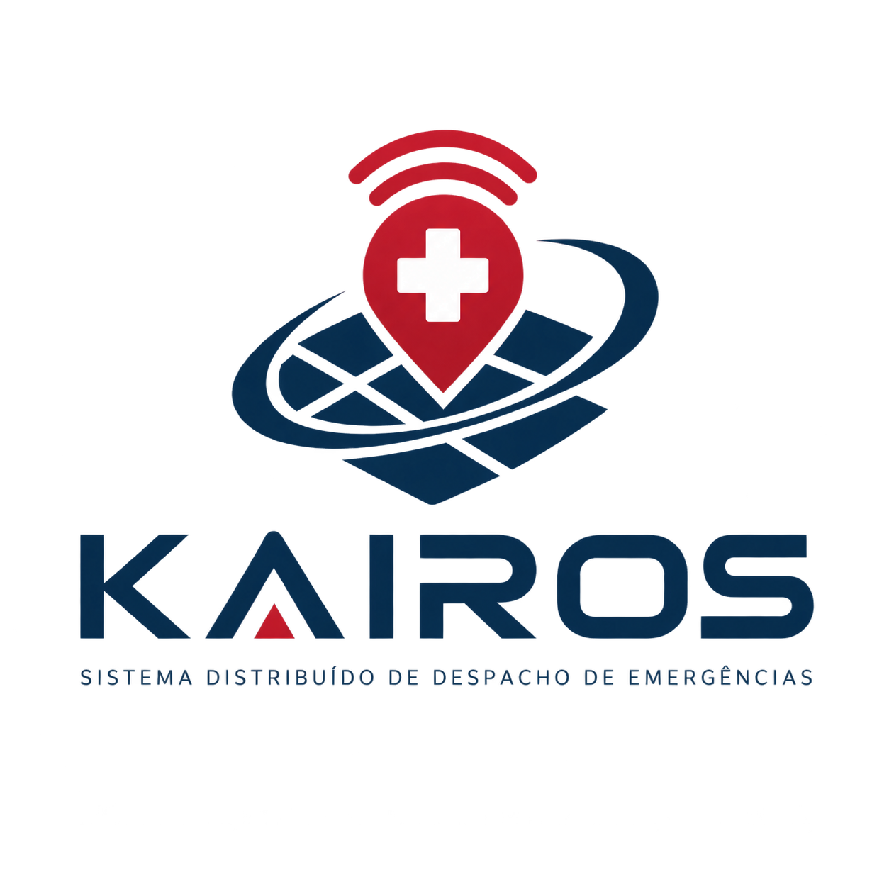

# Documentação Organizada — Kairos

Este ficheiro serve como guia para encontrar rapidamente os documentos, diagramas e componentes do projeto Kairos.

## 1. Documentação técnica

Pasta: `Projeto_Kairos/04_Documentacao_Tecnica/`

- `01_Introducao.md` — Introdução ao projeto.
- `Introducao.md` — Documento de introdução existente.
- `G08_Kairos_relatorio_v1.md` — Relatório técnico em Markdown.
- `G08_Kairos_relatorio_v1.pdf` — Relatório técnico em PDF.
- `documentacao_organizada.md` — Guia com os caminhos dos ficheiros do projeto.

## 2. Diagramas e planeamento

Pasta: `Projeto_Kairos/04_Documentacao_Tecnica/`

- `Diagrama_de_Arquitetura.svg` — Diagrama da arquitetura do sistema.

  

- `casos_de_uso_V1.svg` — Diagrama de casos de uso.
`Diagrama_de_Arquitetura.svg` — Diagrama da arquitetura do sistema.

  

- `uml_dominio_V1.svg` — Diagrama UML do domínio.
- `Gantt_09_10.svg` — Planeamento do projeto através de um gráfico de Gantt.

## 3. Código-fonte

Na pasta principal `Projeto_Kairos/`:

- `api/` — Código do backend e API.
- `frontend/` — Código da interface web.
- `docker-compose.yml` — Configuração dos serviços executados com Docker Compose.

## 4. Organização geral do projeto

Na pasta principal `Projeto_Kairos/`:

- `00_Identificacao/` — Identificação do projeto.
- `01_Memoria_Descritiva/` — Memória descritiva.
- `02_Imagens/` — Imagens do projeto.
- `03_Videos/` — Vídeos do projeto.
- `04_Documentacao_Tecnica/` — Documentação técnica e diagramas.
- `05_Artefactos/` — Artefactos produzidos durante o desenvolvimento.
- `06_Dados_Investigacao/` — Dados de investigação.
- `07_Autorizacoes/` — Autorizações.

## 5. Repositório

[Repositório GitHub do projeto Kairos](https://github.com/MelhorNarrador/Projeto_de_Desenvolvimento_de_Software/tree/main/Projeto_Kairos)

Este guia permite localizar os principais ficheiros do projeto sem ser necessário consultar toda a estrutura de pastas.
